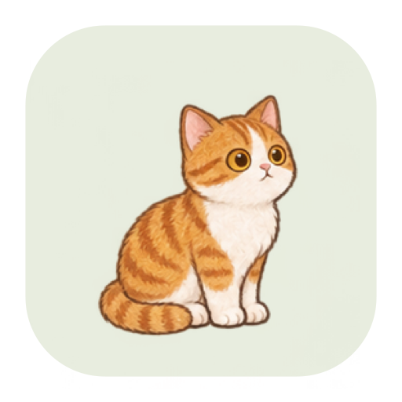
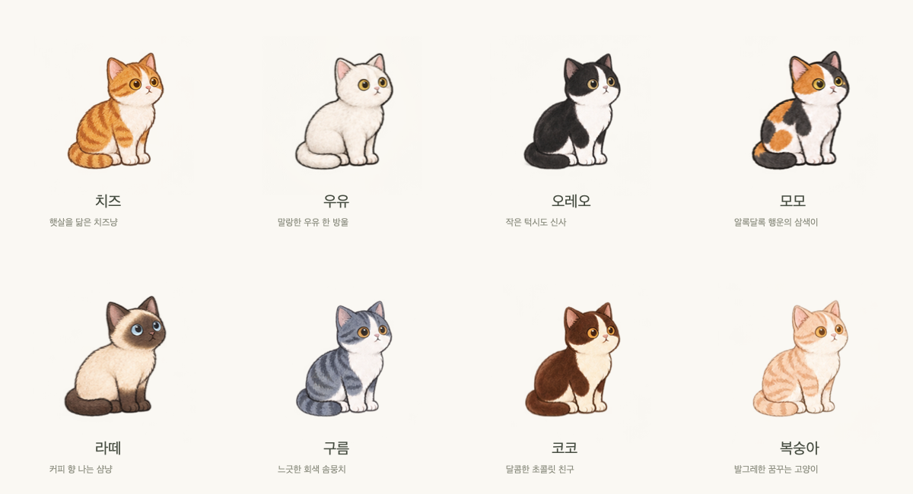

  

<h1 align="center">MacCat</h1>

  화면 위를 사뿐사뿐 돌아다니는 작은 고양이 친구.

  <a href="https://github.com/jhaemin/MacCat/releases/latest"><strong>Mac용 다운로드</strong></a>
  · macOS 14 이상 · Apple Silicon &amp; Intel

## 일하는 시간에도, 쉬는 시간에도

MacCat은 Mac 화면 위에서 함께 지내는 작은 고양이입니다. 창 위를 산책하다가 잠시 앉아 쉬고, 기지개를 켜고, 어느새 새근새근 잠들기도 해요. 손그림의 따뜻한 질감과 작은 움직임이 평범한 바탕화면에 생기를 더합니다.

## 마음에 드는 고양이를 만나보세요

치즈, 우유, 오레오, 모모, 라떼, 구름, 코코, 복숭아. 서로 다른 모습의 고양이 여덟 마리 중 오늘 함께할 친구를 골라보세요.

## 작은 친구와 함께하는 방법

- **클릭**해서 쓰다듬어 주세요.
- **드래그**해서 원하는 곳으로 옮겨 주세요. 다른 화면으로 데려갈 수도 있어요.
- **더블클릭**하면 다음 고양이를 만날 수 있어요.
- **우클릭**하거나 메뉴 막대의 고양이를 누르면 설정을 열 수 있어요.

고양이의 크기와 산책 속도를 조절하고, 화면 곳곳을 돌아다닐지 아래쪽에서만 산책할지 정해보세요. 집중하고 싶을 때는 산책을 잠깐 멈추거나 숨길 수 있고, 클릭 통과를 켜면 고양이 뒤의 창을 바로 사용할 수 있습니다.

## Mac을 켜면 다시 만나요

마음에 드는 고양이와 설정을 기억합니다. 로그인 시 자동 실행을 켜두면 Mac을 켤 때마다 함께할 수 있어요. Dock에는 자리를 차지하지 않고 메뉴 막대에서 조용히 기다립니다.

## 시작하기

1. [최신 버전](https://github.com/jhaemin/MacCat/releases/latest)에서 **MacCat.zip**을 다운로드하세요.
2. 압축을 풀고 **MacCat.app**을 **응용 프로그램** 폴더로 옮기세요.
3. 앱을 열고 메뉴 막대의 고양이 → **고양이 만나기…**에서 친구를 골라보세요.

macOS 14 이상에서 사용할 수 있으며 Apple Silicon과 Intel Mac을 모두 지원합니다. 새 버전은 앱에서 자동으로 확인하며, **업데이트 확인…** 메뉴로 직접 확인할 수도 있습니다.

---

문제가 있거나 아이디어가 떠올랐다면 [Issues](https://github.com/jhaemin/MacCat/issues)에 남겨주세요. 개발과 배포에 관한 내용은 [개발 문서](DEVELOPMENT.md)와 [배포 문서](DEPLOYMENT.md)에 정리되어 있습니다.
